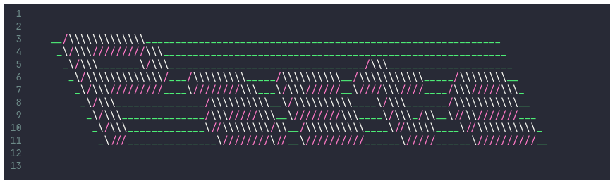
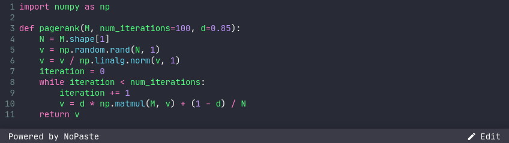

# NoPaste

[][intro-img]

## Was ist NoPaste?

### [NoPaste](https://nopaste.boris.sh/) ist eine Open-Source-Website ähnlich wie Pastebin, auf der du jeden Code speichern und Links zum einfachen Teilen generieren kannst

Was NoPaste besonders macht, ist, dass es mit **keiner Datenbank** und
**keinem Back-End-Code** funktioniert. Stattdessen werden die Daten komprimiert
und **vollständig im Link** gespeichert, den du teilst, nirgendwo sonst!

### Wegen dieser Gestaltung

    - 🗑️ Deine Daten **können nicht gelöscht** werden von NoPaste
    - 🔞 Deine Daten **können nicht zensiert** werden
    - 👁️ Der Server, der NoPaste hostet (oder einen Klon davon) **kann deine
      Daten nicht lesen oder zugreifen**
    - ⏳ Deine Daten sind **für immer** zugänglich (solange du den Link hast)
    - 🔀 Du kannst auf deine Daten auf **jedem NoPaste-Klon** zugreifen,
      einschließlich [deinem eigenen](https://github.com/bokub/nopaste/wiki/Deploy-your-own-version-of-NoPaste)
    - 🔍 Google wird deine Daten **nicht indexieren**, auch wenn dein Link
      öffentlich ist

> **Hinweis:** Dieses Projekt ist eine Kopie von [Topaz's Paste-Dienst][topaz-example],
> mit überarbeitetem Design und ein paar zusätzlichen Funktionen (Syntax-Highlighting,
> Zeilennummern, Offline-Nutzung, Einbettung...)

## Wie es funktioniert

Wenn du auf "Link generieren" klickst, komprimiert NoPaste den ganzen Text mit dem
[LZMA-Algorithmus](https://en.wikipedia.org/wiki/Lempel%E2%80%93Ziv%E2%80%93Markov_chain_algorithm),
kodiert ihn in [Base64](https://en.wikipedia.org/wiki/Base64) und fügt ihn in
das optionale URL-Fragment nach dem `#`-Symbol ein:
`nopaste.boris.sh/#<deine Daten gehen hier hin>`

Wenn du einen Link öffnest, liest NoPaste, dekodiert und dekomprimiert das,
was nach dem `#` kommt, und zeigt das Ergebnis im Editor an.

Dieser Prozess wird vollständig **in deinem Browser** durchgeführt, und der
Webserver, der NoPaste hostet, [hat nie Zugriff auf das Fragment](https://en.wikipedia.org/wiki/Fragment_identifier)

Zum Beispiel, [dies ist der CSS-Code, der von NoPaste verwendet wird][example]

## Weitere Funktionen

### Eingebettete NoPaste-Snippets

Du kannst NoPaste-Code-Snippets auf deine eigene Website einbinden, indem du
auf die _Einbetten_-Schaltfläche klickst und den generierten HTML-Code
verwendest.

Hier ist ein Beispiel für generierten Code und wie er aussieht (klick auf den Screenshot
um die interaktive Version zu sehen)

    <iframe
        width="100%"
        height="243"
        frameborder="0"
        src="https://nopaste.boris.sh/?l=py#XQAAAQAbAQAAAAAAAAA0m0pnuFI8c+qagMoNTEcTIfyUWbZjtjmBYcmJSzoNwS5iVMWHzvowv3IPM0vOG5cjrtDRTSVP/0biTIrrahfmbkuMQBBeSiSGpaJOqYJiKmUDYn2Gp1RtWE6gm8fLHMB4eyZ3+rEbUQwWyMcmWqvZ7m96RUeFyZdYbE85JGvhghqF8cyPB0ZjV0OQWsDxn5O5ysMrIcL+pKPk89EtLjAHhA1LZL9F3hzAtTx7I+GlyrxhhXGxAN//CvtaAA=="
    ></iframe>

Fühle dich frei, die `height`- und `width`-Attribute zu bearbeiten,
um sie deinen Anforderungen anzupassen

### Offline-Nutzung

Wenn du NoPaste zum ersten Mal besuchst, wird sein Code in deinem Browser
Cache gespeichert. Nach dem Laden alle NoPaste-Links, die du öffnest,
werden wirklich schnell geladen, auch wenn deine Internetverbindung langsam ist.

Was ist, wenn du überhaupt keine Internetverbindung hast? Kein Problem,
NoPaste funktioniert immer noch perfekt!

### Editor-Funktionen

    - Syntax-Hervorhebung (verwende den Sprachselektor)
    - Zeilenumbruch aktivieren / deaktivieren (verwende die Schaltfläche neben
      dem Sprachselektor)
    - Zeile löschen (`Strg+D`)
    - Mehrere Cursor (`Strg+Klick`)
    - Übliche Tastenkombinationen (`Strg+A`, `Strg+Z`, `Strg+Y`...)

## Maximale Größen für Links

NoPaste ist großartig zum Teilen von Code-Snippets auf verschiedenen Plattformen.

Dies sind die maximalen Link-Längen auf einigen Apps und Browsern.

| App     | Max. Länge |
| ------- | ---------- |
| Reddit  | 10.000     |
| Twitter | 4.088      |
| Slack   | 4.000      |
| QR-Code | 2.610      |
| Bitly   | 2.048      |
| TinyURL | 32.000     |

| Browser         | Max. Länge  | Hinweise                    |
| --------------- | ----------- | --------------------------- |
| Google Chrome   | (win) 32779 | (mac) 10000, längere nicht  |
| Firefox         | >64000      |                             |
| Microsoft IE 11 | 4043        | Zeigt >2083 nicht an        |
| Microsoft Edge  | 2083        | Alles >2083 schlägt fehl    |
| Android         | 8192        |                             |
| Safari          | Viel        |                             |

## NoPaste-Links generieren

NoPaste-Links können einfach von der Befehlszeile deines Systems erstellt werden:

    # Linux
    echo -n 'Hello World' | lzma | base64 -w0 | xargs -0 printf "https://nopaste.boris.sh/#%s\n"

    # Mac
    echo -n 'Hello World' | lzma | base64 | xargs -0 printf "https://nopaste.boris.sh/#%s\n"

    # Windows / WSL / Linux
    echo -n 'Hello World' | xz --format=lzma | base64 -w0 | \
      printf "https://nopaste.boris.sh/#%s\n" "$(cat -)"

## Stellen Sie Ihre eigene Version von NoPaste bereit

NoPaste ist nur eine Menge statischer Dateien, was es wirklich einfach macht, auf
jede Art von Dateiserver bereitzustellen.

Lies [das Wiki](https://github.com/bokub/nopaste/wiki/Deploy-your-own-version-of-NoPaste)
um zu sehen, wie du deine eigene Version von NoPaste kostenlos mithilfe von Github
Pages bereitgestellt kannst

[intro-img]: https://nopaste.boris.sh/?l=tcl#XQAAAQA6BAAAAAAAAAAFYH9MXlzSsUdj4vga48M86Ff/Bo1HzNmlXzjCWCN1Q/EliRJg00jhrYF9eDKWzDi+Su+Pv1o8yGz3V06CtGOt8u9dUN10KuOrmkUrjI/kUqitUUD34YXmq9twyrkxmOl5kaHPNqE2PWTRhnKWCEntngrOOlXC4kxxnXuGB2v4zJ75fIM0htURHr9ysHH+1nHvSRng4zpcYju3Y/RqpGTIowXGoUcIOeKKG8PpYf/9t33i
[example]: https://nopaste.boris.sh/?l=css#XQAAAQB2DQAAAAAAAAAXioAj/ZZaukKWizx++f8w08qY+xe+w0AeNB0EtEDMR1jPECOrMSz2rcy5XqUVTzusmFXo407ujwufsB1Va3cy02BV4Chx15I+SbM8Ei2WS8/MaZa0wIOjHf0s6B9Kcwi1J73qYeIcKm39PEWGnBM4Ym5aXFOF1Irrn1N95vEcl4YI+98rydudZHmsNCmt995GvCpLImwH7yj3SlMadWaQA0jHCrY1ZBvhjSJ9mAAdYjCJLduITZuXomgpqtr3sYI1WKeRGNmPSD8J8WRLtCx0BZl3yWZZrUxJbmVod8cYiPJnlO+CzQA03qA/GZnxhMYd9TPc2Xlq8UIhBX6gmvo/xhHJc/WHnuBFB32xJ37O5FZlZuXGy6wFE/lakVteoqEqgvyan4LfaiL0pMfYapWjV8YoPa/KyVGugANNjvtRw0hRr+Z1IgKoVL2a1xqvQiB65vIXkw68/ui82O1ko9HTbsLMHX/2/CgWZ8TkTEvgr0+dzVqQYIpaWpB3hDnUTHMkG2UehM5iJyJXAgODNqk8IiWCJn5k/j2FeFpchSTWdgi7AeaCowubmWnFTNgNFXLf5zzARWBUGQFT55TiC0ah4HL17jG3rY6fXvAXlm6CWc88ne7wF0opHkLnhfPslssDYo75hDmCfYwJ6asQ/YBkSuuLJjdCEXVjF7Pdw2FhsOiiB0gNXC6ehieM28M+PMGSDRqt0Q0KveMgE44YJ8zFOvpu2Gg41qDkrsYS7Xb/iMnHz66tt69I1rGzrHx88PuI2/CZx+kv+z7a+/Eiq4JC3KTDx4IbNUYptmrIOC2bxGrcjd8TBKGe+dNi8a/PEnXrUXc/OD7D680/Awo+scE8VKuRVN5R7OPg0tmKVQSQkyCf+I3//kGmREyhh6/bCv6tvbEc7hNPNE1js2svlVBF001JlLY7g1w6ls2pjxrKxuCLrkjba1n4s5WlfrbwcX18rqgbfL2tVibHggsy3Lgq4i7fXtuO3JifxfauO66YIRjEWFnACrHbZ14FbHDMylN7GMvo5TusxestU0s6+kiibWq2qZVpi7C5JVKURNQrGEabICn5nUDoOPMZSfNrdmlTOhu4qjKW09XdQPNazTMc83KjG1YOKNjRP23i1oav5muBFRGMDkSXt7wCgv5PCpLZM9w2jC5GCa5oHuH92IWJu5d80fvTRw3GxNQzfMRxgjzfH6xxrzu+EghhbzayUhb3U5aSRSxOtPTPfjT9mxgk7j3f1mRlbYheuhko4/LBIKYvfA5CnN2Yr3VyBYqoZ/ZgP871LU0ix8ZLeaecao0SDj6V35bZ6RB53mcU8BRPfcyZhj0H6BrFcrcfXKVwnNVro/cIrwnoG3GwlpCXGYJmDDeUdlbBj2HrVmvMncd3w8SzPtxw5RAWQP9YPJdE4Tc490BMX4zAkPqirRHLcxG/K5ECLtKtGsnCkg24+XwFo4XRcGfMsbkSSYD7oZ2HkD+1NXYqJKgk+7uee+yrYCZF6xbsb0ca/7r3w8nU9DueSa6XPiaCLSeJ+phw8iK1U4+FcCzqLW4LzgfcGjz64+HM+Xst0YuqzrAI2RU80H2Mr0FnC/qL+klbM+p0yNUBxBd4IQ64SJmh6Irgi7fZq2wfuTuVEAI1qKKwGwBQ6x9UDyY/OqkD63mtRL//oHeipA==
[topaz-example]: https://topaz.github.io/paste/#XQAAAQAJAQAAAAAAAAAFFgvDUiqpf8dDPleMqfsqtbQYE28suCtDTB9iyFgGByXgSRMepMuokjoACV4UPgBzwM3p+V/N2rCi8m90FkQfsRuMJ4LrZVFgr81wKDc2okcywbJBz7OGNPpc8xu2lAkpSekqRO+I/OYUUvgB2ckKBp+2avxmAKn6H73WV3t1D5Ip9hwthecGUnLwFSGpPFNI0zb4Ettx7QnIu6NiftBuencR3Bn/l3BNoh8Cb9/uIt3FrH30NrlH01bYPAXPUiTF+44uiFU+zc+owfgB+JPKg/wm72I=
